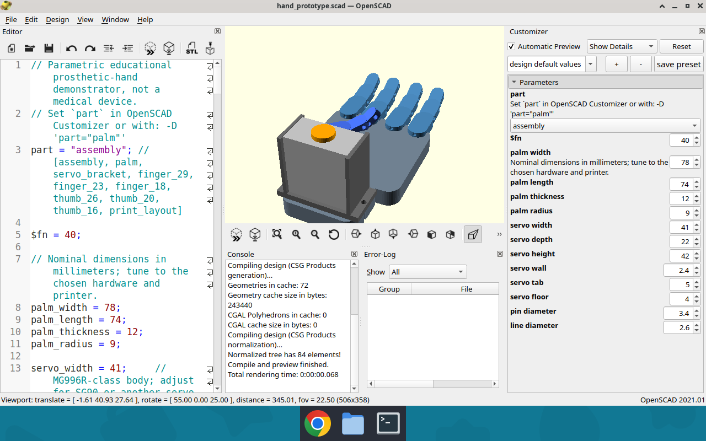
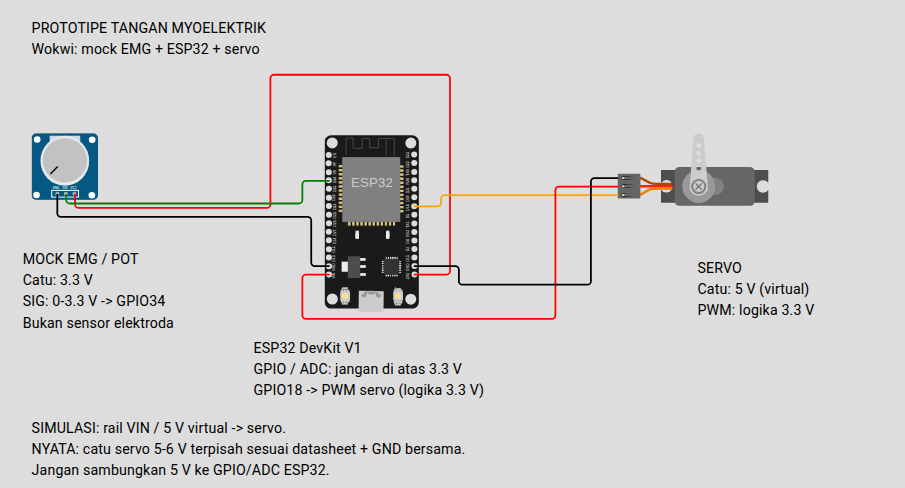

# Prototipe Tangan Prostetik Myoelektrik — ESP32

Proyek edukasional untuk menguji alur sinyal EMG → filter → target servo pada ESP32. Isinya mencakup firmware PlatformIO, model CAD parametris OpenSCAD yang bisa diedit, STL untuk prototipe meja kerja, dan diagram rangkaian Wokwi. Ini **bukan perangkat medis/prostesis siap pakai**.

## Isi proyek

- `src/` dan `include/` — firmware C++: baseline rileks, rectification, moving window, fitur MAV/RMS, threshold/hysteresis, telemetry, dan gerak servo bertahap.
- `platformio.ini` — build untuk ESP32 DevKit (`esp32dev`) dan library `ESP32Servo`.
- `mechanical/hand_prototype.scad` — file sumber CAD OpenSCAD; termasuk pod elektronik generik di bawah pergelangan yang parameternya bisa diedit.
- `mechanical/exports/*.stl` — telapak, bracket servo, base/lid enclosure, link jari/ibu jari, dan layout cetak.
- `mechanical/exports/openscad-application.png` — screenshot langsung dari OpenSCAD yang memperlihatkan source, parameter Customizer, dan model 3D; ini dokumentasi aplikasi CAD, bukan gambar AI.
- `diagram.json` + `wokwi.toml` — ESP32, potensiometer sebagai mock sensor EMG, dan servo untuk simulasi.
- `wokwi/circuit-documentation.png` — gambar canvas Wokwi asli dengan keterangan voltase.
- `tools/serial-monitor.js` — CLI Node.js untuk membaca telemetry serial; parser dapat dites tanpa perangkat.
- `test/` — tes logika C++ native, tes parser Node.js, dan pemeriksaan struktur diagram Wokwi.
- [`docs/processing-pipeline.md`](docs/processing-pipeline.md) — alur sinyal, batas integrasi analog, dan hal yang belum diimplementasikan.
- [`docs/hardware-interface.md`](docs/hardware-interface.md) — peta interface konseptual dan rencana validasi hardware.

## Build dan tes firmware

Build untuk ESP32:

```bash
pio run
```

Tes lokal tanpa board:

```bash
bash test/run_native_tests.sh
python3 test/validate_wokwi_diagram.py
npm test
```

Di VS Code, buka folder proyek, gunakan PlatformIO IDE, lalu pilih **PlatformIO: Build**. Untuk upload/monitor hardware gunakan board dan port yang benar; firmware memakai Serial Monitor 115200 baud.

## Kalibrasi firmware

Kirim karakter melalui Serial Monitor:

- `r` — ukur baseline 3 detik saat otot rileks.
- `c` — ukur kontraksi 3 detik setelah baseline berhasil.
- `a` — aktifkan kontrol otomatis setelah dua kalibrasi berhasil.
- `o` / `m` — perintah manual untuk buka / sudut genggam uji tanpa beban.
- `?` — bantuan.

Pin, pemilihan fitur (MAV bawaan atau RMS), threshold, rentang sudut, dan waktu halus ada di `include/config.h`. MAV dan RMS dihitung pada jendela 25 sampel; fitur terpilih dipakai untuk kalibrasi serta kontrol. Sudut bawaan hanya titik awal; sesuaikan mekanisme secara bertahap di meja kerja.

## Pemantau serial Node.js

Pasang dependensi, lihat port, lalu hubungkan pemantau pada baud 115200:

```bash
npm install
npm run serial-monitor -- --list-ports
npm run serial-monitor -- --port /dev/ttyUSB0
# Windows: npm run serial-monitor -- --port COM3
```

Pemantau hanya membaca telemetry dan dapat dihentikan dengan Ctrl-C. Lihat [dokumentasi alur sinyal](docs/processing-pipeline.md) untuk format data, rumus, batas perangkat keras, dan catatan keselamatan.

## Model CAD 3D

Buka `mechanical/hand_prototype.scad` di aplikasi OpenSCAD untuk mengedit model. Atur pilihan `part` dan dimensi lewat Customizer, atau langsung ubah parameter di file. Ekspor ulang STL dan preview dengan:

```bash
bash mechanical/export_parts.sh
```



Petunjuk dimensi, cetak, dan perakitan ada di `mechanical/README.md`. Bentuknya demonstrator satu-servo dengan tendon dan return elastis, bukan socket yang dipasangkan ke tubuh.

## Rangkaian Wokwi

Diagram dan firmware mapping ada di `diagram.json` dan `wokwi.toml`. Build dahulu dengan `pio run`, lalu di VS Code pilih **Wokwi: Start Simulator** melalui Command Palette (F1). [Petunjuk lengkap dan tabel voltase/pin](wokwi/README.md).



Potensiometer mock memakai **3,3 V**, input GPIO34 nominal **0–3,3 V**, dan PWM GPIO18 berlogika **3,3 V**. Servo pada diagram memakai rail **VIN / 5 V virtual**; pada hardware nyata gunakan catu **5–6 V terpisah sesuai datasheet servo** dengan GND bersama. Nama pin simulator adalah `D34`, `D18`, dan `VIN`; nomor GPIO firmware tetap 34 dan 18.

Gambar adalah dokumentasi statis dari canvas Wokwi di VS Code. Build ESP32 dan tes native sudah lolos, tetapi simulasi runtime Wokwi belum diuji karena lisensi ekstensi belum aktif.

Potensiometer di simulator hanya meniru nilai analog yang dapat diputar; ia tidak merekam atau meniru fisiologi EMG, elektroda, noise, arus motor, beban tendon, atau gaya genggam. Rangkaian fisik wajib memakai keluaran sensor yang sudah dikondisikan dan aman untuk ADC.

## Keselamatan

- GPIO34 menerima input analog; jangan sambungkan elektroda mentah atau tegangan di atas 3,3 V ke GPIO/ADC ESP32.
- Servo perlu catu 5–6 V terpisah sesuai datasheet yang mampu menangani arus stall servo; satukan GND catu servo, sensor, dan ESP32. Jangan menyalakan servo dari pin 3V3/5V board atau USB pada perangkat nyata.
- Uji mekanisme tanpa beban, gunakan pemutus daya yang mudah dijangkau, dan hindari pinch point. Input sensor terlepas/mengambang belum dideteksi firmware dan dapat menghasilkan gerakan tak terduga.
- Model CAD belum diuji kekuatan, ukuran, kenyamanan, atau keselamatan. Jangan dipasang pada tubuh maupun dipakai sebagai perangkat bantu/medis tanpa tinjauan profesional dan validasi keselamatan.

## Lisensi

Proyek ini dilisensikan di bawah [MIT License](LICENSE).
