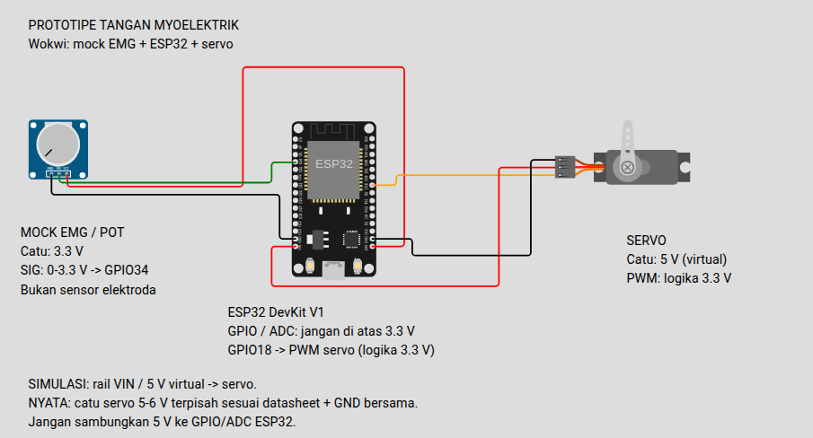

# Rangkaian Wokwi dan tegangan

Proyek memakai `diagram.json` dan `wokwi.toml` di root. Rangkaian terdiri dari ESP32 DevKit V1, potensiometer sebagai **mock input EMG**, satu servo, dan lima label keterangan. Potensiometer bukan sensor atau elektroda EMG.

## Dokumentasi rangkaian

Gambar berasal dari canvas **Wokwi Diagram Editor di VS Code**, dipotong hanya untuk menampilkan rangkaian beserta keterangannya. Komponen, kabel, dan teks tidak digambar ulang. Ini dokumentasi tata letak **statis**, bukan bukti simulasi berjalan.

## Berapa voltasenya?

| Bagian | Tegangan pada diagram | Catatan perangkat nyata |
|---|---|---|
| ESP32 DevKit V1 | Rail `VIN` virtual = **5 V**; logika GPIO = **3,3 V** | ESP32 berlogika 3,3 V. Gunakan sumber board sesuai spesifikasi board; GPIO bukan input 5 V. |
| Potensiometer mock EMG | VCC = **3,3 V**; SIG nominal = **0–3,3 V** | Ini hanya sumber input analog uji. Sensor nyata harus memiliki keluaran yang sudah dikondisikan dan tidak melampaui 3,3 V. |
| ADC GPIO34 | Batas input rangkaian = **0–3,3 V** | Bukan jaminan rentang ukur linear ADC sampai kedua ujungnya; karakteristik ADC/attenuation perlu diperiksa pada board nyata. |
| Servo V+ | **5 V virtual** dari `VIN` pada diagram | Gunakan catu **5–6 V terpisah sesuai datasheet servo**, dengan kemampuan arus stall yang memadai. Jangan mengambil daya motor dari pin board/USB. |
| Servo PWM / GPIO18 | Logika **3,3 V** | Ini tegangan sinyal kontrol, bukan catu motor. Pastikan servo nyata menerima level logika 3,3 V. |
| GND | Referensi **0 V**, disatukan | Satukan GND ESP32, sensor, dan catu servo. |

**Jangan menghubungkan 5 V ke pin GPIO/ADC ESP32.** Nilai tegangan saja tidak membuktikan keamanan rangkaian yang menyentuh tubuh; proyek ini untuk uji meja kerja, bukan untuk dipasang pada tubuh.

## Wiring simulasi

| Komponen | Pin komponen | Pin ESP32 Wokwi | Tegangan/fungsi |
|---|---|---|---|
| Potensiometer mock EMG | VCC | `3V3` | Catu 3,3 V |
| Potensiometer mock EMG | GND | `GND.2` | 0 V bersama |
| Potensiometer mock EMG | SIG | `D34` | Analog nominal 0–3,3 V → GPIO34 |
| Servo | PWM | `D18` | Sinyal PWM berlogika 3,3 V → GPIO18 |
| Servo | V+ | `VIN` | Catu **5 V virtual**, hanya simulator |
| Servo | GND | `GND.1` | 0 V bersama |

Nama pin komponen Wokwi DevKit V1 adalah `D34`, `D18`, dan `VIN`; di firmware nomor GPIO tetap `34` dan `18`. Dua pin GND di atas memiliki referensi ground yang sama.

## Jalankan dari VS Code

1. Build firmware dari root dengan `pio run`.
2. Pasang ekstensi **Wokwi for VS Code**. Buka `diagram.json` untuk melihat diagram; aktivasi lisensi Wokwi mungkin diperlukan untuk menjalankan simulator atau mengedit secara interaktif.
3. Pilih **Wokwi: Start Simulator** dari Command Palette (F1).
4. Di Serial Monitor, kirim `r` ketika potensiometer di posisi rendah/rileks selama 3 detik.
5. Putar potensiometer ke posisi tinggi dan kirim `c` untuk kalibrasi 3 detik. Setelah berhasil, kirim `a` untuk mengaktifkan mode otomatis.
6. Putar kenop untuk menguji target sudut servo. Perintah `o` dan `m` hanya untuk uji gerak tanpa beban.

Build ESP32 dan tes logika native sudah lolos. Diagram sudah ditampilkan di Wokwi serta diperiksa sebagai JSON dengan **3 komponen elektrik, 5 label, dan 6 kabel**. Validator lokal memeriksa koneksi yang diharapkan, bukan mesin simulasi Wokwi. **Simulasi runtime Wokwi belum diuji**; lisensi ekstensi belum aktif pada komputer ini.

## Yang tidak dibuktikan simulator

Potensiometer hanya memberi nilai analog yang dapat diputar; ia tidak merekam EMG atau meniru elektroda, noise, penguatan, maupun dinamika otot. Simulasi juga tidak membuktikan arus stall, tegangan drop, kekuatan tendon, gaya genggam, atau keselamatan gerakan. Sensor dan mekanisme nyata perlu validasi terpisah.

## Referensi

- [Format diagram dan routing kabel Wokwi](https://docs.wokwi.com/diagram-format)
- [Definisi resmi pin ESP32 DevKit V1 Wokwi](https://github.com/wokwi/wokwi-boards/blob/main/boards/esp32-devkit-v1/board.json)
- [Potensiometer Wokwi](https://docs.wokwi.com/parts/wokwi-potentiometer)
- [Servo Wokwi](https://docs.wokwi.com/parts/wokwi-servo)
- [Label teks Wokwi](https://docs.wokwi.com/parts/wokwi-text)
- [Konfigurasi Wokwi untuk VS Code](https://docs.wokwi.com/vscode/project-config)
